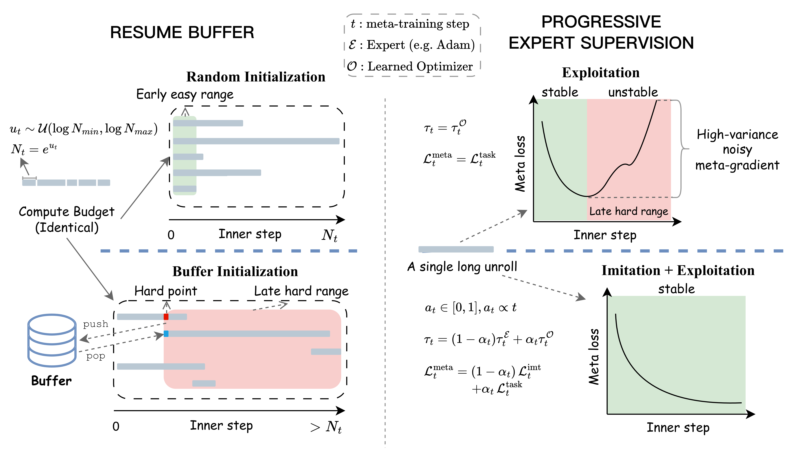

<div align="center">

# Efficient Long-Horizon Learning for Learned Optimization<br>(ELO)

[](https://arxiv.org/abs/2607.06772)
[](https://github.com/Belilovsky-Lab/pylo)
[](https://xiaol827.github.io/ELO-page/)

</div>

**ELO** is an efficient long-horizon meta-learning framework for learned optimization. With less than 7 H100 GPU-hours of meta-training, ELO enables learned optimizers to transfer from small-scale tasks to practical vision (ViT-B/16, ResNet-50 on ImageNet-1K) and language (GPT-2 and GPT-3 on FineWeb) pretraining, outperform well-tuned AdamW across all evaluated tasks, and outperform both AdamW and Muon on GPT-2 (30M and 124M) pretraining.

## Key Features

- **Resume buffer** — reallocates redundant meta-training compute toward longer failure regimes, scaling learned-optimizer meta-training to long inner problems.
- **Progressive expert supervision** — enforces decoupled progressive expert supervision, providing stable meta-learning signals that additionally lead to generalizable LOs.
- **Consistent downstream improvements** — ELO-LOs substantially outperform their base LOs.
- **Cheap to meta-train** — every ELO-LO is trained in under 7 GPU-hours.

<div align="center">
  
</div>

## Usage in Pytorch

This repository is for meta-training and evaluating in Jax. For downstream usage in **PyTorch**, please visit our [PyLO](https://github.com/Belilovsky-Lab/pylo) repo: drop-in LOs that load their meta-learned weights automatically from the Hugging Face Hub. To load a custom checkpoint, pass `hf_key="<user>/<repo>"` or a local `checkpoint_path=...`.

| Optimizer | Weights |
|:--|:--|
| `ELO-CELO2` | [🤗 elo-celo2](https://huggingface.co/DiamondXL/elo-celo2) |
| `ELO` | [🤗 elo-small_fc_lopt](https://huggingface.co/DiamondXL/elo) |


## Installation 
Copy and run this single script to install everything:

```bash
#!/usr/bin/env bash
set -e

export INSTALL_DIR=$PWD
mkdir -p $INSTALL_DIR/l2o_install && cd $INSTALL_DIR/l2o_install

# Install UV and setup Python environment
curl -LsSf https://astral.sh/uv/install.sh | sh
export PATH="$HOME/.local/bin:$PATH"
uv venv -p 3.11 .venv && source .venv/bin/activate
export UV_COMPILE_BYTECODE=1 UV_LINK_MODE=copy

git clone https://github.com/xiaol827/ELO.git ELO && cd ELO

pushd learned_optimization && uv pip install -e . && popd

# Clone and install vision_transformer
git clone https://github.com/google-research/vision_transformer
pushd vision_transformer && git checkout ac6e056 && uv pip install -e . && popd

# Install all dependencies in one command
uv pip install \
    mmengine seqio wandb aiofiles gin-config optax_shampoo transformers \
    torch torchvision dm-haiku chex flax mpi4py huggingface_hub \
    "jax[cuda12]==0.9.0" orbax-checkpoint==0.3.2 \
    git+https://github.com/haydn-jones/SOAP_JAX \
    git+https://github.com/google-deepmind/optax.git

# big_vision extras: tensorflow_addons (EOL) is required by
# big_vision/pp/archive/autoaugment.py and only works against the Keras 2 API
# exposed by `tf-keras`. Pin tensorflow / tensorflow-text / tf-keras to the
# 2.20.x triplet (the latest line for which all three publish matching wheels).
uv pip install \
    tensorflow==2.20.0 \
    tensorflow-text==2.20.1 \
    tf-keras==2.20.1 \
    tensorflow_addons==0.23.0

# Route `import keras` to tf-keras: tensorflow_addons references private
# Keras 2 internals (e.g. keras.src.engine) that do not exist in Keras 3,
# which TF >= 2.16 installs as the default `keras` package.
SITE_PACKAGES=$(python -c "import sysconfig; print(sysconfig.get_paths()['purelib'])")
rm -rf "$SITE_PACKAGES/keras"
ln -snf tf_keras "$SITE_PACKAGES/keras"

# Setup data directories (adjust paths as needed)
mkdir -p ~/scratch/tensorflow_datasets ~/scratch/wandb
ln -sf ~/scratch/tensorflow_datasets data
ln -sf ~/scratch/wandb wandb

# Create setup.sh for future sessions
cat > $INSTALL_DIR/l2o_install/setup.sh << EOF
# Set this to your installation directory (where you ran the install script)
export INSTALL_DIR=$INSTALL_DIR

source \$INSTALL_DIR/l2o_install/.venv/bin/activate
cd \$INSTALL_DIR/l2o_install/ELO
export LD_LIBRARY_PATH=\$LD_LIBRARY_PATH:/usr/include
export WANDB_API_KEY=<WANDB_API_KEY>
export MASTER_NODE=\$HOSTNAME
export MASTER_PORT=12345
export TFDS_DATA_DIR=\$PWD/data
export WANDB_DIR=\$PWD/wandb
EOF

echo "Installation complete! Run 'source $INSTALL_DIR/l2o_install/setup.sh' to activate."
```

After installation, edit `setup.sh` to:
1. Verify `INSTALL_DIR` is set to the correct path (should be auto-populated during installation)
2. Replace `YOUR_WANDB_API_KEY_HERE` with your actual WANDB API key

Then activate the environment with:
```bash
source /path/to/l2o_install/setup.sh
```

## Download data

All datasets live under `$TFDS_DATA_DIR` (set to `$PWD/data` by `setup.sh`).

### Meta-training tasks (small image classification)

The meta-training tasks — `mlp-w32-d1_mnist-8x8x1`, `mlp-w32-d1_fashionmnist-8x8x1`,
`mlp-w32-d1_cifar10-8x8x3`, `mlp-w32-d1_svhn-8x8x3` — use the standard TFDS
datasets, downscaled to 8×8 on the fly. Fetch them once:

```bash
python -m big_vision.tools.download_tfds_datasets mnist fashion_mnist cifar10 svhn_cropped
```

### Meta-testing datasets

```bash
# ImageNet-32 (image classification)
python tools/download_dataset.py --output_dir data --repo_id btherien/imagenet-32x32x3

# Fineweb-edu 10B (language modeling)
mkdir -p data/fineweb_edu_10B
python tools/download_dataset.py --output_dir data/fineweb_edu_10B --repo_id btherien/edufineweb-tokenized
```

### ImageNet-1K (224×224) for Big Vision tasks

`imagenet2012` cannot be downloaded automatically. Manually place the official
`ILSVRC2012_img_train.tar` and `ILSVRC2012_img_val.tar` into
`$TFDS_DATA_DIR/downloads/manual/`, then build the TFDS records (~1h):

```bash
cd big_vision/ && python -m big_vision.tools.download_tfds_datasets imagenet2012
```

## Usage (E.g. ELO-Celo2)

We meta-train on a single GPU (~6.5h on H100; L40S gives nearly the same wall-clock time) and evaluate on 4 H100 by default.

### Meta-training
```
OMP_NUM_THREADS=16 CUDA_VISIBLE_DEVICES=0 python src/main.py \
--config config/meta_train/meta_train_base.py,\
config/learned_optimizer/elo_celo2.py,\
config/inner_length_schedule/constant_2000.py,\
config/gradient_estimators/pes_elo.py,\
config/truncated_step/lopt_elo.py,\
config/data/light_aug.py,\
config/schedule/warmup_cosine_decay.py,\
config/optimizer/adamw.py,\
config/gradient_transform/before/clip_by_global_norm.py,\
config/gradient_transform/after/none.py \
--cfg_options \
task_aug_scale_range=[0.001,1000] \
gradient_transform_before_optim.0.kwargs.max_norm=1.0 \
learned_optimizer_args.kwargs.peak_lr=0.001 \
learned_optimizer_args.kwargs.init_lr=0.001 \
learned_optimizer_args.kwargs.end_lr=0.001 \
learned_optimizer_args.kwargs.warmup_fraction=0.0 \
learned_optimizer_args.kwargs.adam_lr_mult=20 \
learned_optimizer_args.kwargs.weight_decay=0.0 \
learned_optimizer_args.kwargs.expert_lr_max=3.16e-3 \
learned_optimizer_args.kwargs.expert_lr_min=3.16e-3 \
learned_optimizer_args.kwargs.muon_expert_adamlr_scaler=0.3 \
learned_optimizer_args.kwargs.expert_optim=muon \
learned_optimizer_args.kwargs.adam_bias_correction=True \
learned_optimizer_args.kwargs.bias_correction=True \
learned_optimizer_args.kwargs.clip_grad=True \
learned_optimizer_args.kwargs.clip_norm=1.0 \
schedule.kwargs.peak_value=1e-4 \
schedule.kwargs.end_value=1e-5 \
schedule.kwargs.decay_steps=95000 \
schedule.kwargs.warmup_steps=5000 \
inner_problem_length_schedule.sample_choice=uniform \
gradient_estimator_args.kwargs.steps_per_jit=10 \
gradient_estimator_args.kwargs.truncation_length=50 \
gradient_estimator_args.kwargs.expert_wd_sp=7000 \
gradient_estimator_args.kwargs.expert_wd_ep=70000 \
gradient_estimator_args.kwargs.expert_traj_wmin=0.0 \
gradient_estimator_args.kwargs.expert_dirloss_weight=0.7 \
gradient_estimator_args.kwargs.expert_magloss_weight=0.3 \
gradient_estimator_args.kwargs.expert_dirloss_wmin=0.3 \
gradient_estimator_args.kwargs.expert_magloss_wmin=0.0 \
truncated_step_args.kwargs.buffer_cfg.thred=0.5 \
truncated_step_args.kwargs.buffer_cfg.min_thred=0.5 \
truncated_step_args.kwargs.buffer_cfg.buffer_size=1 \
--num_tasks 8 \
--num_outer_steps 100000 \
--local_batch_size 64 64 64 64 \
--train_project ELO-Celo2-meta-train \
--optimizer ELO_Celo2LOpt \
--needs_state \
--name_suffix elo_celo2 \
--prefetch_batches 20 \
--task "mlp-w32-d1_mnist-8x8x1,mlp-w32-d1_fashionmnist-8x8x1,mlp-w32-d1_cifar10-8x8x3,mlp-w32-d1_svhn-8x8x3" \
--use_task_augmentation \
--auto_resume \
--image_dtype float32
```
This will automatically log training metrics and the learned optimizer weights to a W&B run. Be sure to record the **wandb_checkpoint_id** and use it to fill in the **[NEED]** below. For meta-testing we average ("soup") the last checkpoints of the run (steps 97500–100000) via `checkpoint_soup_range`.

--------
### Image classification (ViT-Base/16, ImageNet-1K)
```
python3 -m big_vision.train_lo \
--config big_vision/configs/vit_i1k_elo_celo2.py:variant=B/16,aug=strong8 \
--config.wandb.name elo_celo2_in1k_vitb16_lr3.16e_5_strong8 \
--config.wandb_checkpoint_id [NEED] \
--config.checkpoint_soup_range='(97500,100000)' \
--config.total_steps 50000 \
--config.model.dtype_mm bfloat16 \
--config.input.batch_size 2048 \
--config.lr 3.16e-5 \
--config.wd 0.0001 \
--config.schedule.min_lr_factor 0.01 \
--config.lo_kwargs.init_lr=3.16e-5 \
--config.lo_kwargs.warmup_fraction=0 \
--config.lo_kwargs.initial_rms_decays='(0.95,)' \
--config.lo_kwargs.adam_lr_mult=20 \
--config.lo_kwargs.adam_bias_correction=True \
--config.lo_kwargs.bias_correction=True \
--config.lo_kwargs.clip_grad=True \
--config.lo_kwargs.clip_norm=1.0 \
--config.lo_kwargs.meta_train=False \
--resume
```

### Language Modeling (GPT2 (124M), 2.5B Tokens)
```python
srun bash -c 'OMP_NUM_THREADS=16 python src/main.py \
--config config/meta_test/meta_test_base.py,\
config/data/no_aug.py,\
config/learned_optimizer/elo_celo2.py,\
config/gradient_transform/before/clip_by_global_norm.py,\
config/gradient_transform/after/none.py \
--cfg_options \
learned_optimizer_args.kwargs.meta_train=False \
learned_optimizer_args.kwargs.adam_bias_correction=True \
learned_optimizer_args.kwargs.bias_correction=True \
learned_optimizer_args.kwargs.init_lr=0.0 \
learned_optimizer_args.kwargs.peak_lr=3.16e-4 \
learned_optimizer_args.kwargs.end_lr=3.16e-5 \
learned_optimizer_args.kwargs.weight_decay=0.1 \
learned_optimizer_args.kwargs.adam_lr_mult=20 \
learned_optimizer_args.kwargs.clip_grad=True \
learned_optimizer_args.kwargs.clip_norm=1.0 \
learned_optimizer_args.kwargs.warmup_fraction=0.05 \
--test_project ELO-Celo2 \
--master_port $MASTER_PORT \
--master_node $MASTER_ADDR \
--num_runs 1 \
--local_batch_size 32 \
--ovr_test_batch_size 64 \
--test_accumulate_steps 4 \
--optimizer ELO_Celo2LOpt \
--name_suffix elo_celo2_fb2.5B \
--num_inner_steps 19074 \
--gradient_accumulation_steps 1 \
--test_interval 20 \
--needs_state \
--task "transformer-dense-w768-d12-h12_fineweb-s1024-gpt2" \
--wandb_checkpoint_id [NEED] \
--checkpoint_soup_range 97500 100000 \
--save_iter 500'
```

## Citation

```bibtex
@article{huang2026efficient,
  title={Efficient Long-Horizon Learning for Learned Optimization},
  author={Huang, Xiaolong and Th{\'e}rien, Benjamin and Harrison, James and Belilovsky, Eugene},
  journal={arXiv preprint arXiv:2607.06772},
  year={2026}
}
```
